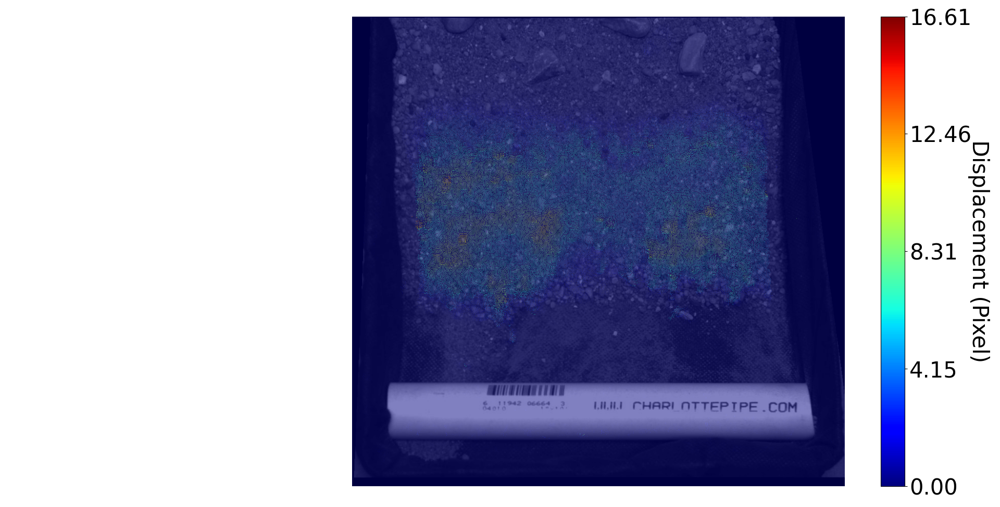

# Sandtracking

Research scripts and figures for sand-surface tracking, image displacement analysis, and 3D point-cloud correspondence, collected from the ISGSR 2025 project folder.

[中文说明](README.zh-CN.md) · [Usage and data requirements](docs/usage.md) · [GitHub upload instructions](docs/github.md)

## Project status

This repository preserves the original experimental scripts and their filenames. The scripts contain local Windows paths, dataset-specific parameters, interactive windows, and exploratory sections. They require external experimental data and configuration before use. The two larger scripts are collections of research experiments rather than a single validated end-to-end pipeline.

The raw image sequences, reconstruction files, camera calibration, and VTU datasets are **not included**. The figures are existing illustrations and results, not a runnable example dataset.

## Contents

```text
sandtracking/
├── scripts/
│   ├── manual_mask.py
│   ├── 3d_DIC.py
│   └── find_point_distance.py
├── figures/                       # Original images, plots, and SVG artwork
│   └── match_result/              # Original feature-matching figures
├── data/README.md                 # External input-data guidance
├── docs/
│   ├── usage.md
│   └── github.md
├── requirements.txt
├── requirements-experiments.txt
├── README.zh-CN.md
└── local_archive/                 # Local copy only; excluded from Git
    ├── manuscripts/
    ├── posters/
    ├── reviews/
    ├── temporary/
    └── file_manifest.json
```

| Script | Purpose |
| --- | --- |
| `manual_mask.py` | Select a four-point polygon, mask an image collection, and preserve EXIF metadata when available. |
| `3d_DIC.py` | Project reconstructed 3D points into camera images, track image motion, inspect correspondence errors, and visualize 3D points. |
| `find_point_distance.py` | Explore VTU point-cloud distances, surface slopes, optical flow, OpenMVG reconstruction data, and triangulation. |

## Setup

Create a Python 3 environment from the repository root. For Windows PowerShell:

```powershell
python -m venv .venv
.\.venv\Scripts\python.exe -m pip install -r requirements.txt
```

For the additional experiments in `find_point_distance.py`:

```powershell
.\.venv\Scripts\python.exe -m pip install -r requirements-experiments.txt
```

Dependencies were identified from the source imports. Original package versions were not recorded, so these files are dependency lists, not tested environment lockfiles. OpenCV, Matplotlib, and PyVista require a graphical desktop for the interactive parts.

Before running a script, follow [the usage guide](docs/usage.md) to configure the input paths, output paths, frame selections, and experiment-specific settings.

## Example figure

An existing image-displacement visualization from the source folder:



All 37 source image and artwork files are preserved in `figures/`, including the four original `match_result` images. Their filenames and contents are unchanged.

## Preservation and verification

The organization copied all 51 source files without deleting or editing the originals: 3 scripts and 37 figures are included in Git's upload scope; 11 manuscript, poster, review, and temporary files are kept in the ignored local archive. A local manifest records the original and destination paths, sizes, and SHA-256 hashes.

All three scripts passed Python 3.11 syntax compilation. Their numerical workflows were not executed or validated because the required datasets and original runtime environment are not included. No algorithm, coordinate convention, unit, threshold, or experimental result was changed during organization.
