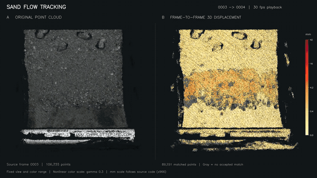

# Sandtracking

从 ISGSR 2025 项目文件夹整理的砂土表面跟踪、图像位移分析和三维点云对应研究脚本。

[English README](README.md) · [运行和数据说明](docs/usage.md) · [上传 GitHub](docs/github.md)

## 沙流追踪与位移视频

[](videos/sand_flow_displacement.mp4)

[观看或下载 MP4](videos/sand_flow_displacement.mp4) · [数据、计算方法与重新生成说明](videos/README.md)

视频使用 `3d_DIC.py` 对应的 `image_collection_mask` 沙流实验。左侧播放原始点云，右侧在同一帧的点云位置上显示到下一帧的三维位移估计。对应关系由图像光流与投影点匹配确定；灰色表示没有通过匹配检查，不能解释为零位移。

视频包含 1,498 组相邻帧（0001→0002 至 1498→1499），分辨率 1920 × 1080，以 30 fps 播放，约 50 秒。两侧视角和全程色标保持固定。沿用原代码的 ×966 毫米换算系数及 0.3 非线性色阶，并在画面和说明中注明；该物理尺度未重新标定。播放速度不代表采集时间。README 动图是 5 fps 的缩小预览。

## 文件安排

| 目录或文件 | 内容 | 是否纳入 Git |
| --- | --- | --- |
| `scripts/` | 3 个原始脚本和 1 个新增视频生成脚本 | 是 |
| `figures/` | 37 个原始图件，包含 `match_result/` | 是 |
| `videos/` | MP4、GIF 预览、封面、生成记录和说明 | 是 |
| `docs/`、`data/README.md` | 使用、数据和上传说明 | 是 |
| `requirements*.txt` | 从脚本导入语句整理的依赖 | 是 |
| `local_archive/manuscripts/` | 7 个论文文档/PDF | 否 |
| `local_archive/posters/` | 2 个海报 PPTX | 否 |
| `local_archive/reviews/` | 1 个审稿文档 | 否 |
| `local_archive/temporary/` | 1 个 Office 临时锁文件 | 否 |
| `local_archive/file_manifest.json` | 全部原文件的路径映射、大小和 SHA-256 | 否 |

原文件夹完整保留；51 个文件均采用复制方式迁入，原始文件名和文件内容未修改。`local_archive/` 已写入 `.gitignore`，普通 `git add .` 不会包含其中的内容。

## 脚本用途

- `manual_mask.py`：手动选择四点多边形，对图像序列进行掩膜，并在可读取时保留 EXIF 信息。
- `3d_DIC.py`：三维点投影、图像光流跟踪、点对应误差分析及三维可视化。
- `find_point_distance.py`：包含 VTU 点云距离、坡度、光流、OpenMVG 数据读取和三角化等探索性代码段。
- `render_sand_flow_video.py`：计算相邻帧三维位移并生成左右同步视频；使用已有 Python 依赖，编码需要 FFmpeg，缺少相机 JSON 时通过 OpenMVG 从原始 `robust.bin` 导出。

## 安装与使用

在仓库根目录打开 PowerShell：

```powershell
python -m venv .venv
.\.venv\Scripts\python.exe -m pip install -r requirements.txt
```

运行 `find_point_distance.py` 中的附加实验还需要：

```powershell
.\.venv\Scripts\python.exe -m pip install -r requirements-experiments.txt
```

脚本保留了原有的 Windows 绝对路径、帧号、阈值和交互窗口。运行前必须按 [使用说明](docs/usage.md) 修改输入输出路径并准备对应数据。两个较大的脚本包含多个实验代码段，不能当作已验证的一键运行流程。

原始图像序列、PLY/VTU 点云、OpenMVG JSON 和标定数据不在本仓库中；`figures/` 中的图件不能代替完整实验数据。依赖版本在原文件夹中没有记录，因此没有编造版本锁定。

## 验证范围

已核对原文件的 SHA-256，并对 3 个原始脚本执行语法检查。新增视频脚本已在实际沙流序列上执行，并通过同帧零位移、已知平移及异常跳点回查测试。这不等同于独立验证实验重建精度或 ×966 物理尺度。视频随附逐帧源文件哈希、匹配数量、误差门限和位移摘要；原始脚本、图件和实验数据未修改。
