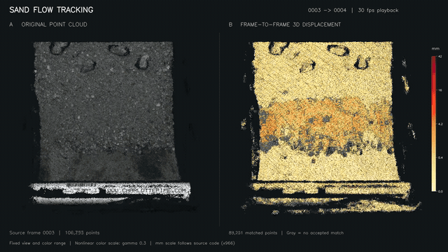

# Sand flow: point cloud and displacement

[](sand_flow_displacement.mp4)

[Watch or download the MP4](sand_flow_displacement.mp4)

## What is displayed

- **Left:** the source frame's original PLY point cloud and RGB attributes, viewed through the calibrated middle camera (`image_json_001.jpg`).
- **Right:** the same source-frame geometry, colored by estimated Euclidean 3D displacement to the next frame. Gray means the point has no accepted correspondence; pale yellow represents low measured displacement.
- Both panels use the same fixed framing and depth ordering. Point footprints are 2 × 2 output pixels. No surface interpolation, smoothing, or source-geometry editing is performed.
- The color range is fixed from zero to the largest accepted displacement over the displayed sequence. The mapping is `(displacement / maximum) ** 0.3`. Tick labels give the actual displacement values at those colors. No displacement clipping or per-frame color rescaling is used.

## Files

| File | Content |
| --- | --- |
| `sand_flow_displacement.mp4` | H.264, 1920 × 1080, 1000 frames at 30 fps; approximately 33.33 seconds. |
| `sand_flow_preview.gif` | Full-duration looping preview, 640 × 360 at 5 fps. |
| `sand_flow_poster.jpg` | The rendered frame showing the 0130→0131 interval used in the original script. |
| `sand_flow_metadata.json` | Source hashes, camera parameters, match counts, rejection limits, displacement summaries, and exact rendering settings. |

The MP4 uses H.264 CRF 26 with a 12 Mbit/s maximum rate and a 24 Mbit buffer to keep the full sequence practical to include in the repository. The poster is saved directly from the rendered frame before video compression.

## Input data

The supplied local dataset is:

```text
E:\SynologyDrive\ryan\image_collection_mask\
    image_set_0001\
        image_json_001.jpg
        reconstruction_global\
            robust_scene_dense.ply
            robust.bin
            robust.json          # Present for some frames
    ...
    image_set_1001\
```

The video displays source frames 0001 through 1000, covering the adjacent pairs 0001→0002 through 1000→1001. Frame 1001 supplies the destination points for the final displacement calculation. No intermediate frame is skipped. Playback FPS is a presentation choice; acquisition timestamps were not established.

Camera parameters are read by view/intrinsic/pose IDs. Missing JSON is exported from the corresponding original `robust.bin` with OpenMVG's `-V -I -E` options. All selected frames' intrinsics, distortion, rotations, and camera centers are checked against each other. The files agree in this dataset, keeping the projection and coordinate frame consistent.

## Displacement method

1. Read XYZ and RGB from each original PLY. Project XYZ with `t = -R @ C`, then normalize homogeneous pixel coordinates. Undistort the corresponding camera image with its recorded calibration.
2. Track projected source points into the next image with Lucas–Kanade optical flow. Settings come from `3d_DIC.py`: a 15 × 15 window, pyramid level 2, and 10 iterations / 0.03 convergence criterion.
3. Track the resulting image points backward. Retain successful, finite, in-image tracks whose per-axis absolute round-trip residuals pass the frame pair's 95th-percentile rule. This added check rejects observed false jumps from the dark boundary onto the white pipe that forward status alone accepted.
4. Match each accepted destination image location to the nearest projected next-frame PLY point. Apply the original 95th-percentile matching idea to **absolute** per-axis pixel residuals. Keep the original source-point index throughout; querying old points with new coordinates would break the temporal correspondence.
5. Compute `norm(X_next_matched - X_source) * 966`. Attach that value to the original source-point location for the right panel. Unmatched points remain explicitly gray.

The ×966 conversion and millimeter label are retained from the original author's `3d_DIC.py`; that physical calibration was **not independently re-established**. The output is an image-guided 3D displacement estimate, not ground-truth grain motion. Reconstruction noise, occlusion, and ambiguous correspondences can still produce residual errors, including large boundary values. The full accepted range is retained in the color mapping. Pairwise matching is recomputed for each interval; this is not a persistent particle identity or a cumulative-displacement trajectory through the entire experiment.

The renderer preserves source-point indices and uses absolute residual quantiles and a backward consistency check with the 95% rule. These checks reduce correspondence errors without modifying the input point clouds.

## Reproduce

Install the repository's `requirements.txt`. Provide FFmpeg on `PATH`, and configure the existing OpenMVG `ConvertSfM_DataFormat` executable if any frames only have `robust.bin`.

Set the paths at the top of [`render_sand_flow_video.py`](../scripts/render_sand_flow_video.py), then run from the repository root:

```powershell
.\.venv\Scripts\python.exe .\scripts\render_sand_flow_video.py
```

Input files are read only. Analysis arrays and exported camera JSON go into the ignored `outputs/sand_flow_cache/`; public MP4/GIF/poster/metadata go into `videos/`. Rerunning replaces these generated files. The script uses NumPy/OpenCV depth rasterization without VTK/PyVista.

## Verification

The correspondence calculation was checked with the same real frame as both inputs (zero displacement), a deterministic synthetic 2-pixel translation (correct point identities and expected 9.66 mm under the test calibration), and a previously observed 100.746 mm boundary jump (rejected by the backward check). These are computational checks, not an independent physical validation of the experiment or its scale.

Every analyzed frame records input-file hashes. Sources are checked again during rendering. Per-pair match counts, round-trip residual limits, projected matching limits, and 0/50/90/95/99/100 percentiles of displacement are available in the metadata, including gray/rejected-point counts through the recorded totals.
